# Отчёт: мониторинг Flask-сервиса

## 1. Подопытный сервис и запуск

В начале моей просьбе гпт разработал простой Flask-сервис с тремя кнопками для получения HTTP 500, задержки около 2 секунд и нагрузки из 100 запросов к самому себе, 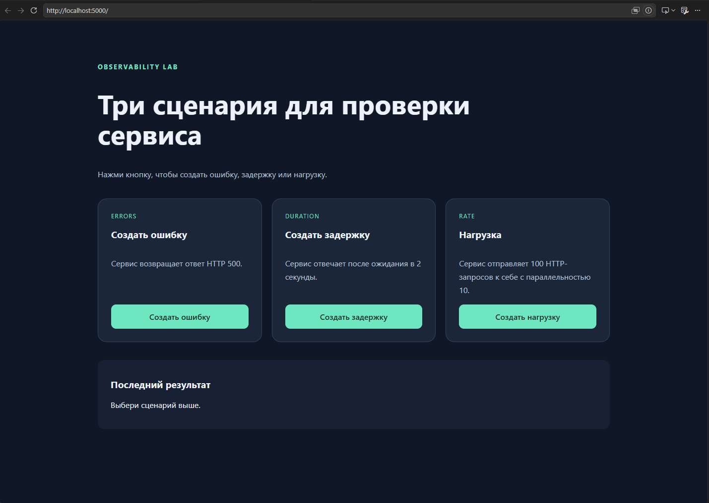. Flask выбрал т.к. уже работал с ним и у него удобно можно логику расписать в python файле, а страницу и остальное сделать в index.html, styles.css. Весь код находится в папке server. Также был добавлен Dockerfile.

Был создан compose.yaml, чтобы запускать сразу все контейнеры, далее все запускалось через
```
docker compose -f lecture-2-monitoring-observability/compose.yaml up -d --build
```
Сначала ИИ сгенерировал сервер сразу со сбором метрик, но затем мы откатили до чистого сервиса и потом самостоятельно были добавлены opentelemetry и prometheus_client.

Были добавлены счетчики для ошибок и запросов, а для запросов сделан отдельный подсчет по типам запроса:


```
REQUESTS = Counter(
    'http_requests_total',
    'Total number of HTTP requests',
    ['method'],
)

ERRORS = Counter(
    'http_errors_total',
    'Total number of HTTP 5xx responses',
)

DURATION = Histogram(
    'http_request_duration_seconds',
    'HTTP request duration in seconds',
    buckets=(0.01, 0.05, 0.1, 0.5, 1, 2, 3, 5),
)
```


## 2. Сбор метрик Prometheus и Grafana

Prometheus был настроен, чтобы собирать метрики с http://server:5000/metrics каждые 5 секунд; успешный сбор подтверждён состоянием UP, 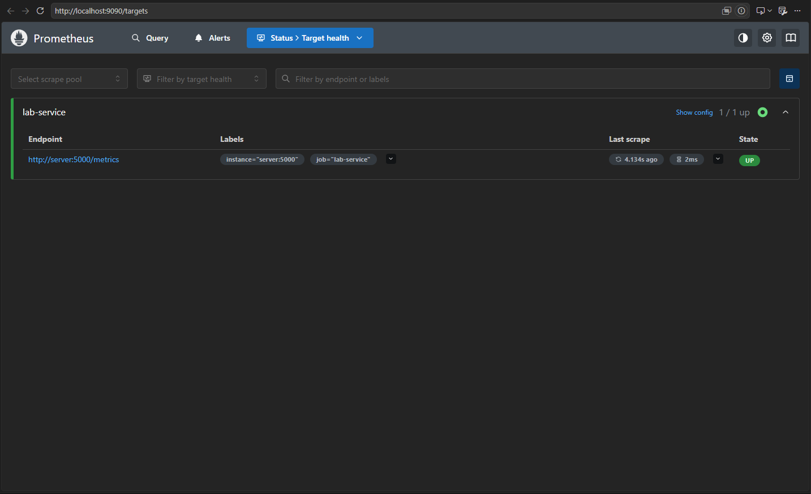. Запросы на этот эндпоинт в статистике не учитываются.

В Grafana через конфигурационные файлы подключён Prometheus и создан дашборд с интенсивностью запросов, долей ошибок и p95 времени ответа, 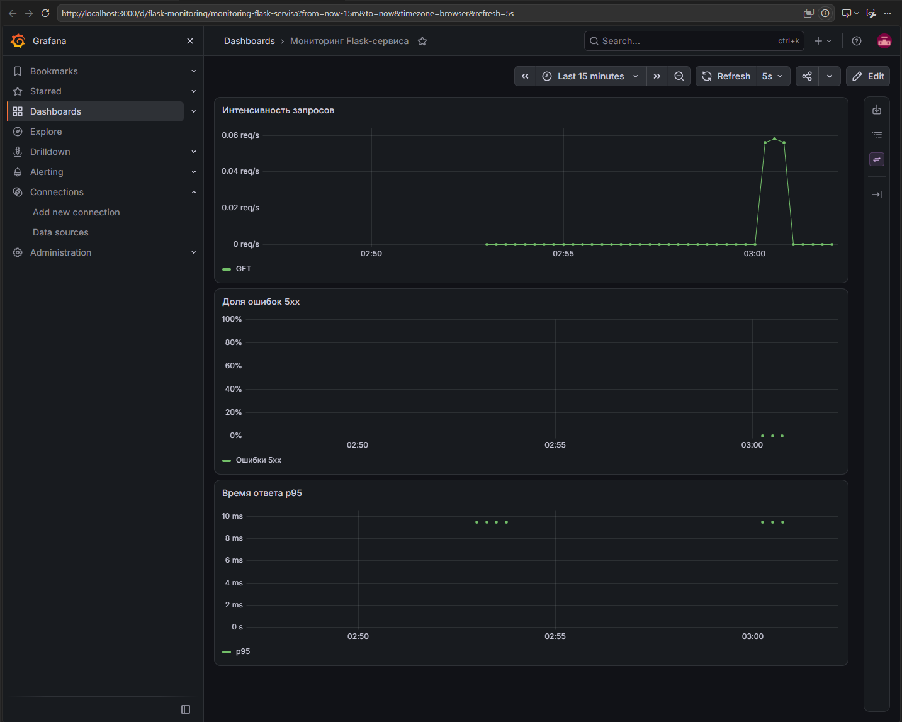.

Интенсивность вычисляется как rate(http_requests_total[1m]), доля ошибок считается, как отношение интенсивности 5xx к интенсивности всех запросов, умноженное на 100, p95 считается через histogram_quantile по корзинам гистограммы. Эти показатели позволяют увидеть нагрузку, ошибки и замедление сервиса. Было опытным путем выяснено, что в запрос определенным временем падает во все корзины меньше этого времени.

### Проблема: доля ошибок выше 100%

При проверке на графике появилась доля ошибок 150%, что явно не правда 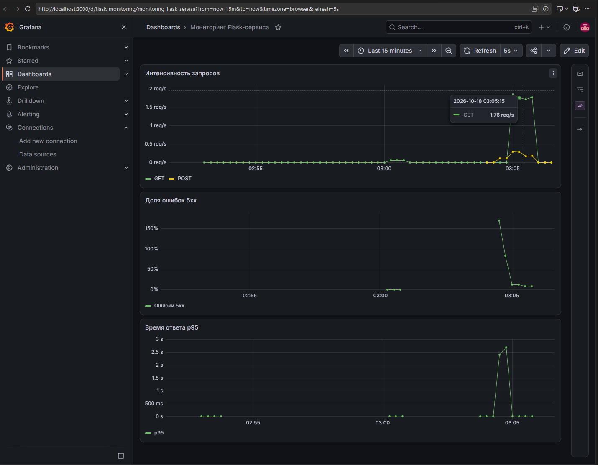.

Причина была обнаружена потом при помощи ии-агента. Она появлялась в моменте появления временных рядов: счётчик ошибок без меток существовал с нулём сразу, а серия запросов конкретного метода создавалась только при первом обращении к ней:

```
REQUESTS = Counter(
    'http_requests_total',
    'Total number of HTTP requests',
    ['method'],
)
```


Но счетчик для конткреного вида запроса создавался впервые только при первом запросе:


```
REQUESTS.labels(method='POST').inc()
```


При этом счётчик ошибок без меток создавался сразу:

```
ERRORS = Counter(
    'http_errors_total',
    'Total number of HTTP 5xx responses',
)
```


Ошибка была исправлена через то, чтоб заранее создать нулевые серии для всех используемых методов:


```
for method in ("GET", "POST", "other"):
    REQUESTS.labels(method=method)
```


После пересборки сервиса и накопления начальных отсчётов доля ошибок отображалась правильно 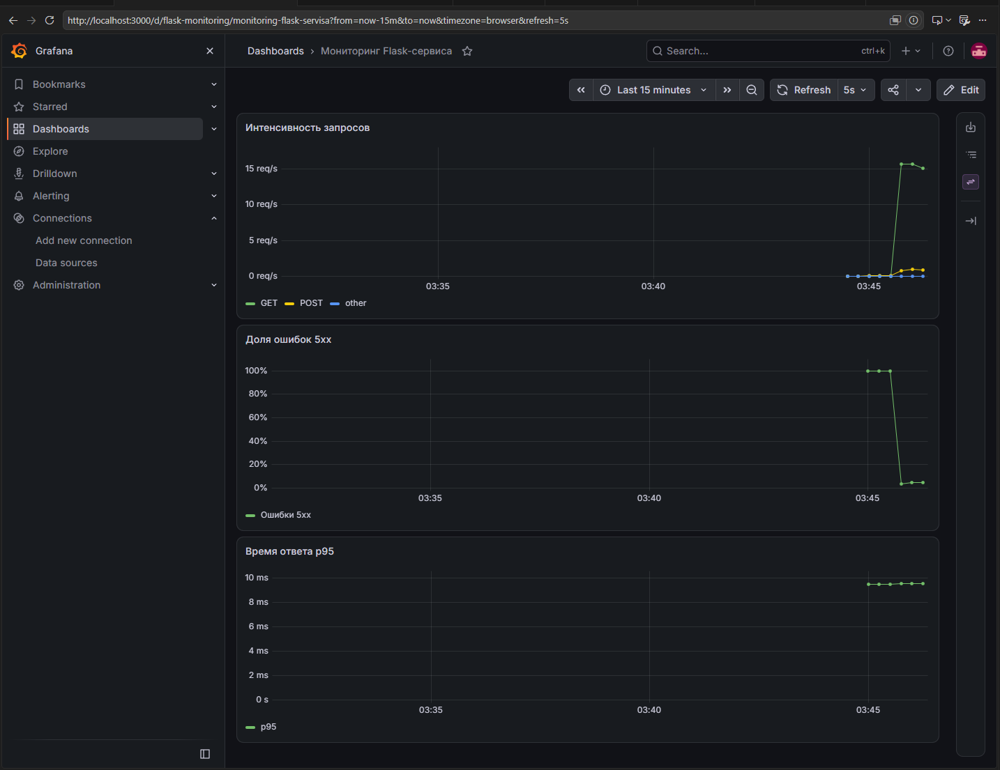.

## 4. JSON-логи, Promtail и Loki

Приложение было настроено так, чтобы JSON-логи писались в stdout, Promtail читает докер-логи и отправляет их в Loki, а Grafana позволяет найти ошибку 500 и её trace_id, 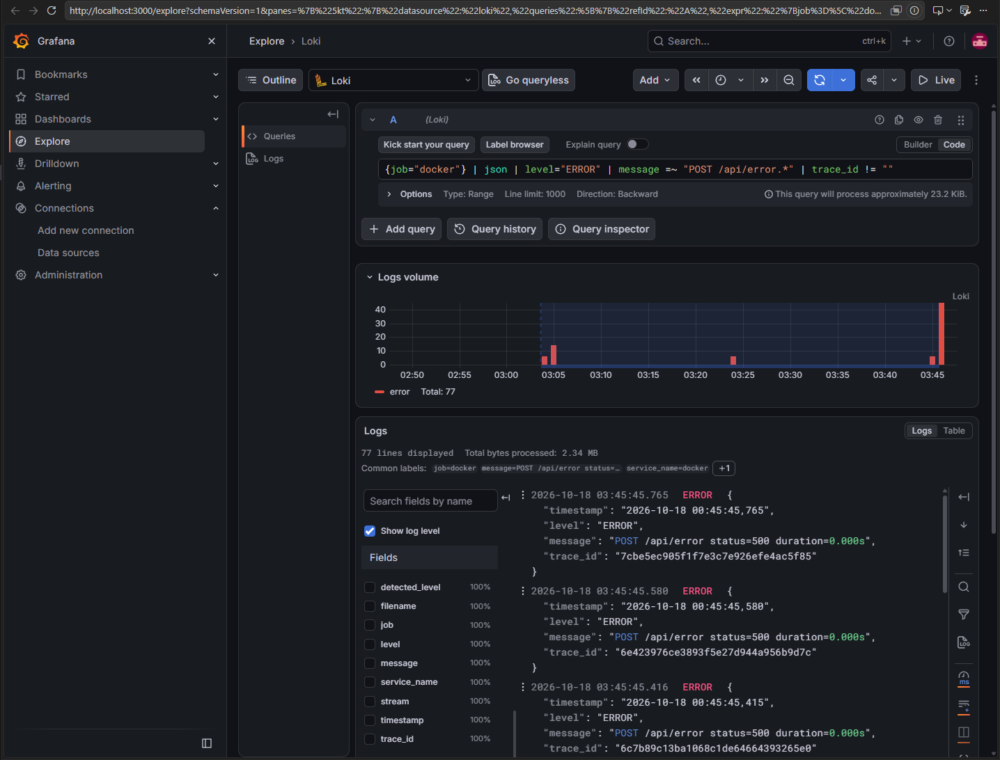. Также для долгих запросов был добавлен дополнительный спан: операция time.sleep(2) обёрнута в дочерний спан slow-dependency, поэтому в водопаде видно, где потрачено время, 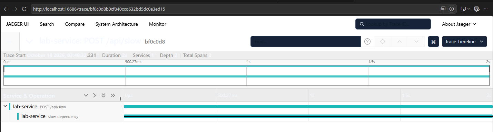.

Для форматирования использованы logging.Formatter и StreamHandler(sys.stdout). В JSON добавлены время, уровень, сообщение и затем trace_id. Получение логов в Grafana подтвердило работу всей цепочки сбора.

## 5. Трейсы OpenTelemetry и Jaeger

Через OpenTelemetry подключено автоматическое инструментирование Flask и экспорт в Jaeger. В поиске внутри Jaeger видны обычные, медленные и ошибочные запросы, 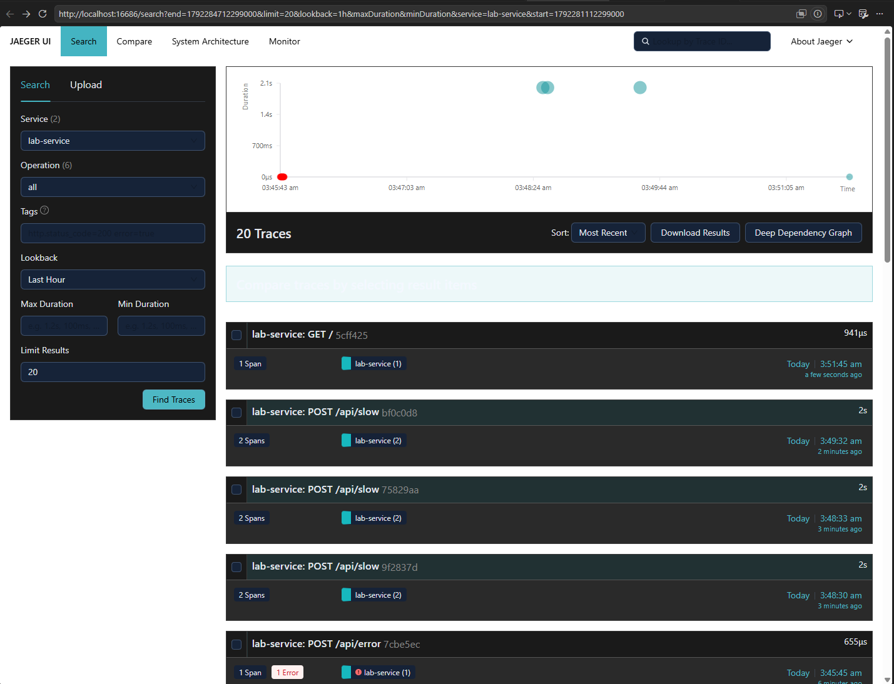.

При первом запуске экспорт завершался HTTP 404: в OTEL_EXPORTER_OTLP_ENDPOINT ошибочно был указан путь /v1/traces, который экспортёр добавляет сам. Адрес был исправлен на http://jaeger:4318, после чего трейсы появились.

В Jaeger еще есть какая-то проблема с оформлением, белый текст на белом фоне. Причину установить и как-то пофиксить пока не удалось(

### Ошибочный спан и связь с логами

Обработчик /api/error помечает текущий спан статусом ERROR. Открытый трейс имеет тот же идентификатор 7cbe5ec905f1f7e3c7e926efe4ac5f85, что и JSON-запись в Loki  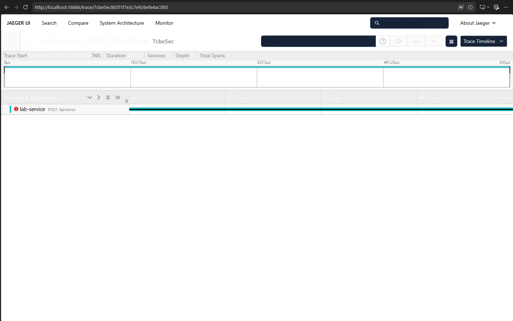. Это позволяет перейти от лога ошибки к конкретному трейсу.

## 6. Алерты Prometheus и Alertmanager

В Prometheus настроены три правила, которые после выдержки for: 30s направляют алерты в Alertmanager, а тот отправляет уведомления локальному webhook-сервису. Это вспомогательный Flask-сервис, который написал агент. С него можно получить логи в файл, т.к. он принимает POST /alerts, выводит JSON в stdout и отвечает HTTP 200. Сохранённый журнал уведомлений: [журнал webhook](screenshots/webhook.txt), пример активного алерта: 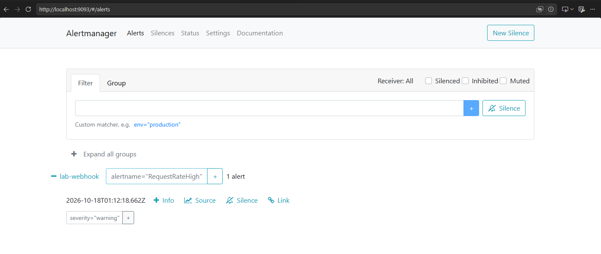.

Правила оцениваются раз в минуту, поэтому для проверки нагрузка или ошибки поддерживались длительно: короткая пачка могла выйти из минутного окна до следующей оценки.

Во время части проверок страница Prometheus /alerts показывала INACTIVE, хотя API и webhook подтверждали ErrorRateHigh в состоянии firing. Причина этого расхождения тоже пока непонятна.


### Алерты

RequestRateHigh срабатывает при суммарной интенсивности выше 1 запроса в секунду и позволяет заметить всплеск нагрузки, способный привести к перегрузке .

ErrorRateHigh срабатывает при доле HTTP 5xx выше 5% и выявляет ситуации, когда пользователи массово получают неуспешные ответы, 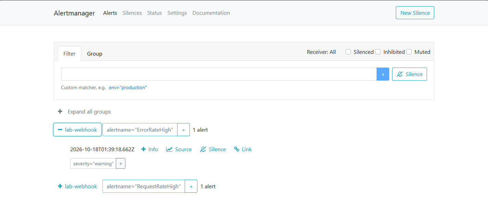.

P95High срабатывает, когда оценка p95 выше 1 секунды, и позволяет обнаружить ухудшение времени ответа сервиса, 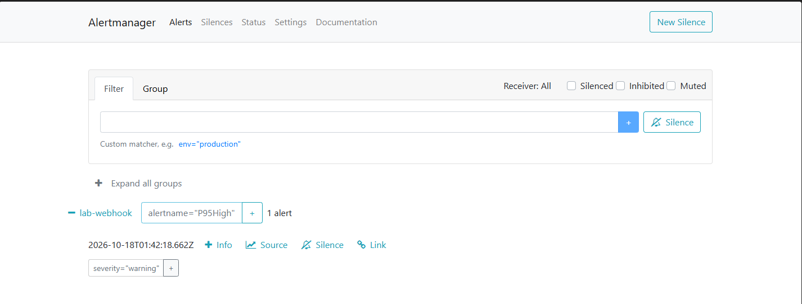.

## Вывод

В лабораторной для небольшого Flask-сервиса был собран полный контур мониторинга по всем трём китам observability: метрики (Prometheus + Grafana), логи (JSON в stdout, Promtail, Loki) и трейсы (OpenTelemetry, Jaeger). Все компоненты подняты декларативно через Docker Compose.

Помимо сборки стека, получено понимание типовых граблейы. Самая содержательная проблема: доля ошибок на дашборде показывала 150% из-за несинхронного появления временных рядов у счётчиков с метками, и лечится она заранее созданием нулевых серий. Также настроены три алерта (интенсивность, доля ошибок, p95) с доставкой уведомлений в webhook, и их проверка показала, что условия алертов нужно выдерживать дольше окна оценки правил, иначе пачка просто выходит из минутного окна.

Практика показала, что связка метрики + логи + трейсы даёт полную картину: метрики сообщают, что что-то не так, логи и трейс раскрывают подробности события, 

